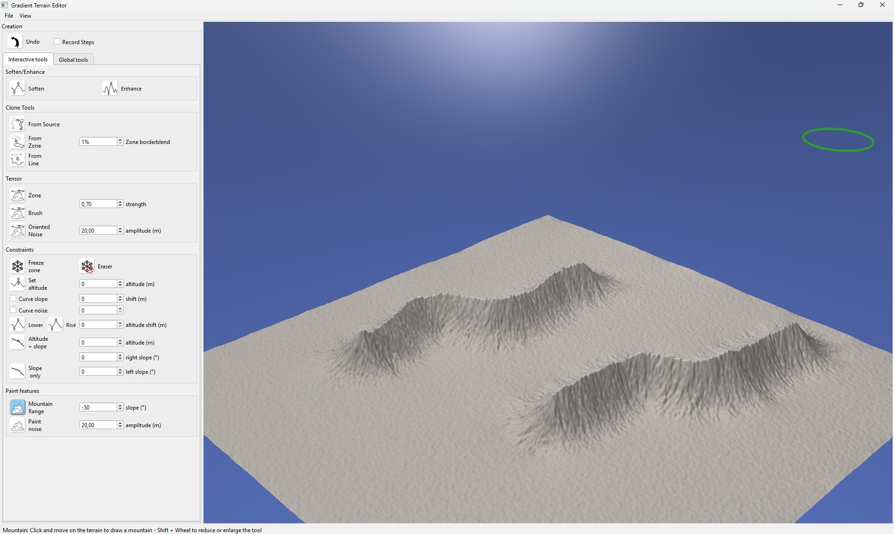

# Gradient Terrain Authoring

[](https://hal.science/hal-03577171/file/2022-gradientterrains.pdf)
[](https://doi.org/10.1111/cgf.14460)
[](https://www.youtube.com/watch?v=tuXs71n2C9I)
[](https://www.youtube.com/watch?v=NKOnwIKfwvY)
[](LICENCE)

This repository contains the C++ source code of the interactive terrain editor of the Computer Graphics Forum paper
**"[Gradient Terrain Authoring](https://hal.science/hal-03577171/file/2022-gradientterrains.pdf)"**,
by Eric Guérin, Adrien Peytavie, Simon Masnou, Julie Digne, Basile Sauvage, James Gain and Eric Galin.



*Two mountain ranges sketched with the Mountain Range brush on a fractal terrain. The terrain is edited in the gradient
domain and the elevation is recovered by a real-time GPU Poisson reconstruction.*

## Abstract

Digital terrains are a foundational element in the computer-generated depiction of natural scenes. Given the variety and
complexity of real-world landforms, there is a need for authoring solutions that achieve perceptually realistic outcomes
without sacrificing artistic control. In this paper, we propose setting aside the elevation domain in favour of modelling
in the gradient domain. Such a slope-based representation is height independent and allows a seamless blending of
disparate landforms from procedural, simulation, and real-world sources. For output, an elevation model can always be
recovered using Poisson reconstruction, which can include Dirichlet conditions to constrain the elevation of points and
curves. In terms of authoring our approach has numerous benefits. It provides artists with a complete toolbox, including:
cut-and-paste operations that support warping as needed to fit the destination terrain, brushes to modify region
characteristics, and sketching to provide point and curve constraints on both elevation and gradient. It is also a
unifying representation that enables the inclusion of tools from the spectrum of existing procedural and simulation
methods, such as painting localised high-frequency noise or hydraulic erosion, without breaking the formalism. Finally,
our constrained reconstruction is GPU optimized and executes in real-time, which promotes productive cycles of iterative
authoring.

## Videos

The video of the paper:

[](https://www.youtube.com/watch?v=tuXs71n2C9I)

The video of the presentation:

[](https://www.youtube.com/watch?v=NKOnwIKfwvY)

More videos are available on the [Arches Team YouTube channel](https://www.youtube.com/@ArchesTeam).

## Fundamentals

The editor sculpts a terrain by editing its **gradient field** instead of its elevations.
Every tool modifies slopes (soften, enhance, clone, tilt, add noise...) or adds elevation constraints
(freeze a region, force an altitude or a slope). After each edit the height field is **reconstructed** by solving a
Poisson equation on the GPU, so the terrain stays consistent while the constraints are respected.

* The terrain is stored in `GradientTerrain` as a 2D vector field **g** (the gradient of the height field), plus two
  scalar fields used for the constraints: a mask `alpha` (1 where the terrain is free, 0 where it is frozen) and an
  altitude `alt` (the altitude imposed where the terrain is frozen).
* The tools change `g`, `alpha` and `alt` only.
* **Reconstruct** (`GradientTerrain::UpdateHeightField`) computes the divergence of **g** and solves
  **Δh = div(g)** for the height *h* with a geometric multigrid, implemented as an OpenGL compute shader
  ([mgstepfloat.glsl](AppGradientTerrains/Shaders/mgstepfloat.glsl)), honouring the constraints. The result is meshed,
  shaded and displayed.
* With *Auto reconstruct* on (default) the terrain is reconstructed after every edit.
* Undo restores the previous gradient and constraints.

The application has two tool tabs, **Interactive tools** (brushes and selections on the 3D view) and
**Global tools** (operations on the whole terrain), next to a 3D view of the terrain. It starts with a 513 x 513
fractal (fBm) terrain and the **Mountain Range** tool selected. It needs an **OpenGL 4.3** capable GPU (compute shaders)
and a compatibility profile context (the 3D view still uses legacy fixed-function calls such as `gluLookAt`).

## List of tools

### Menus

| Menu | Entry | Effect |
| --- | --- | --- |
| File | New - Noise Terrain (FBM) | Generates a new 513 x 513 or 1025 x 1025 fractal terrain |
| File | Load > Load Heightfield | Opens a grayscale PNG as a height field |
| File | Load > Load Gradient | Opens a PNG whose red and green channels encode the gradient |
| File | Export > HeightField, OBJ | Exports the terrain as a PNG height field or as a mesh |
| File | Save (8 bits) / Save (32 bits) | Saves the displayed height field as a PNG |
| View | Constraints overlay | Darkens the frozen areas in the 3D view |
| View | Auto reconstruct | Reconstructs the terrain after every edit |
| View | Reconstruct (Ctrl+R) | Reconstructs the terrain now |

Input images must be square (for instance 513 x 513 or 1025 x 1025): the multigrid solver works on square grids.

The top of the panel has an **Undo** button (also `Ctrl+Z`) and **Record Steps**, which writes images of every
reconstruction (terrain, constraints, mask, Laplacian) in `./export/<date>/`.

### Interactive tools

| Group | Tool | What it does |
| --- | --- | --- |
| Soften/Enhance | Soften, Enhance | Locally decreases or increases the slopes under the brush |
| Clone Tools | From Source | Copies the gradients around a source point (Ctrl+click) onto the brush stroke |
| | From Zone | Pastes a zone selected with the lasso (Ctrl+drag) at the clicked position; *Zone borderblend* is the width of the blend at the border |
| | From Line | Copies the gradients along a source line (Ctrl+drag) onto another line drawn with the mouse |
| Tensor | Zone | Orients the slopes inside a lasso zone along a drawn direction (*strength*) |
| | Brush, Oriented Noise | Applies a tensor along the direction of the stroke, or adds noise oriented along it (*amplitude*) |
| Constraints | Freeze zone | Freezes the current altitude under the brush |
| | Eraser | Removes the constraints under the brush |
| | Set altitude | Imposes an altitude (Ctrl+click picks it from the terrain), optionally with a *Curve slope* and *Curve noise* |
| | Lower, Rise | Moves the existing constraints down or up by the *altitude shift* |
| | Altitude + slope, Slope only | Imposes an altitude and/or a left and right slope along the stroke |
| Paint features | Mountain Range | Draws a mountain ridge with the given *slope* |
| | Paint noise | Adds noise under the brush (*amplitude*) |

### Global tools

| Group | Tool | What it does |
| --- | --- | --- |
| Soften/Enhance | Soften, Enhance | Divides or multiplies all the slopes by 1.2 |
| Constraints | Freeze River, Freeze Ridges | Freezes the river network (from the stream area) or the ridge network (from the PPA analysis); *Restrict to selected zone* limits it to the lasso zone |
| | Sync Gradient | Rebuilds the gradient from the current height field, so that the constraints can be removed without changing the terrain |
| | Erase All | Removes every constraint |
| Erosion | Erosion | Hydraulic erosion on the GPU (particle based) |

### Mouse and keyboard

| Action | Effect |
| --- | --- |
| Left click / drag | Applies the selected tool |
| Mouse wheel | Zooms toward the terrain |
| Shift + wheel | Changes the radius of the tool |
| Alt + left drag | Rotates the camera |
| Alt + middle drag | Pans the camera |
| Alt + right drag | Moves the camera forward or backward |
| Double click | Centers the camera on the picked point |
| Ctrl + click / drag | Picks a source point, an altitude, or draws a lasso or a line, depending on the tool |
| Ctrl + Z | Undo |
| Ctrl + C | Shows or hides the constraints overlay |
| Ctrl + R | Reconstruct |

The status bar explains the selected tool.

## Requirements

The code builds with Visual Studio (Windows) and with Makefiles (Linux) from the same `CMakeLists.txt`.
A Visual Studio solution (`AppGradientTerrains.sln`) is also provided for Windows.

You need a C++20 compiler, **Qt 6** (Core, Gui, Widgets, OpenGLWidgets; 6.2 or newer), OpenGL with GLU,
GLEW (shipped in `Libs/LibPlatform` for Windows, a system package on Linux) and optionally OpenMP.

### CMake, Windows

```bat
cmake -S . -B build -G "Visual Studio 17 2022" -A x64 -DCMAKE_PREFIX_PATH=D:/Qt6/6.10.1/msvc2022_64
cmake --build build --config Release
build\bin\Release\AppGradient.exe
```

`CMAKE_PREFIX_PATH` can be omitted when the `QTDIR64` environment variable points to the Qt folder.
`build/AppGradientTerrains.sln` can also be opened in Visual Studio. The Qt libraries, `glew32.dll`, the shaders
and the icons are copied next to the executable.

### CMake, Linux

```bash
sudo apt install build-essential cmake qt6-base-dev libglew-dev libglu1-mesa-dev
cmake -S . -B build -DCMAKE_BUILD_TYPE=Release
cmake --build build -j
cd build/bin
./AppGradient
```

The executable must be started from its own folder (`build/bin`, hence the `cd`), or from a working directory
containing `Shaders/` and `UI/Icons/`: the shaders and the icons are read relative to the working directory.
The CMake build copies them next to the executable.
Software OpenGL (`LIBGL_ALWAYS_SOFTWARE=1`, Mesa llvmpipe) is enough to run the application when no GPU driver offers
OpenGL 4.3.

### Visual Studio solution (Windows)

Set `QTDIR64` to the Qt folder, then open `AppGradientTerrains.sln` (or run MSBuild on it) and build. The projects
write to `Out\x64\<Configuration>`. `Script\Deploy.bat` copies `glew32.dll` and the Qt libraries
(`windeployqt`) next to the executables.

## Repository layout

```
CMakeLists.txt             Cross-platform build (Visual Studio and Makefiles)
AppGradientTerrains.sln    Visual Studio solution (uses the .vcxproj files)
Directory.Build.props      Makes the Visual Studio projects use the Libs/ folder
AppGradientTerrains/
  Source/, Include/        The application
    gradientterrain.*      Gradient terrain, constraints and tools, height reconstruction
    geometricmultigrid.*   GPU multigrid Poisson solver
    mayawidget-terraineditor.cpp   3D view, brushes, lasso, mouse and keyboard interaction
    qte-main-window.cpp, callback.cpp   Main window, tool dispatch, loading, global tools
  UI/                      Qt Designer file and tool icons
  Shaders/                 Multigrid compute shader
Libs/                      Trimmed copy of the libraries used by the application
  LibCore                  Math, fields (ScalarField2, VectorField2), meshes, noise, camera
  LibHeightfield           HeightField, shading, GPU erosion
  LibHeightAnalysis        Ridge detection (PPA)
  LibMaya                  OpenGL widget and rendering
  LibPlatform/LibGL        GLEW for Windows
Images/                    Images of this README
LICENCE                    MIT license
Script/Deploy.bat          Windows deployment helper
Data/                      Sample terrains
```

### Runtime notes

* `ARCHESLIBDIR`: the libraries look for their shaders and textures in `$ARCHESLIBDIR/LibMaya/Shaders` and
  `$ARCHESLIBDIR/LibHeightfield/LibHeightfield/Shaders`. At startup the application sets it to the `Libs` folder it finds
  above the executable, or to the one recorded by CMake at configuration time.
* The multigrid shader is read from `./Shaders/mgstepfloat.glsl`, relative to the working directory.
* The 1025 x 1025 fractal terrain uses `1025.png` (in the working directory) as a template for its size.

## Citation

You can use this code in any way you want (see the [license](#license)), however please credit the original article:

> Eric Guérin, Adrien Peytavie, Simon Masnou, Julie Digne, Basile Sauvage, James Gain, and Eric Galin. 2022. Gradient Terrain Authoring. *Computer Graphics Forum* 41, 85–95. https://doi.org/10.1111/cgf.14460

```bibtex
@article{Guerin2022GradientTerrain,
  author  = {Eric Gu{\'e}rin and Adrien Peytavie and Simon Masnou and Julie Digne and Basile Sauvage and James Gain and Eric Galin},
  title   = {Gradient Terrain Authoring},
  journal = {Computer Graphics Forum},
  volume  = {41},
  pages   = {85--95},
  year    = {2022},
  doi     = {10.1111/cgf.14460}
}
```

## Links

- Paper: [PDF](https://hal.science/hal-03577171/file/2022-gradientterrains.pdf) — [DOI 10.1111/cgf.14460](https://doi.org/10.1111/cgf.14460) — [HAL](https://hal.science/hal-03577171)
- Video: [YouTube](https://www.youtube.com/watch?v=tuXs71n2C9I)
- Presentation: [YouTube](https://www.youtube.com/watch?v=NKOnwIKfwvY) — [Arches Team channel](https://www.youtube.com/@ArchesTeam)

## License

See [LICENCE](LICENCE) for details on the license of this project (MIT).

The GLEW headers and library shipped in `Libs/LibPlatform/LibGL` are third-party files and keep their own license
(see the notice at the top of `glew.h`).
